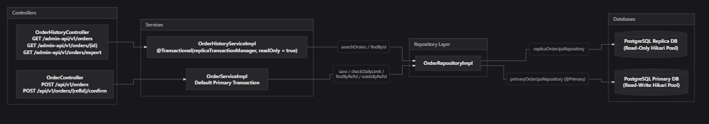

A reusable Spring Boot + Spring Data JPA template for routing selected read operations to a PostgreSQL read replica while keeping writes and consistency-sensitive operations on the primary database.

> **Routing strategy:** explicit repository routing. The application keeps primary and replica repository instances and chooses the correct one in the repository implementation. This makes query routing visible at the method level instead of relying on hidden routing rules.

## Architecture



### Request flow

1. **Controllers**
   - `OrderHistoryController` exposes history, detail, and export endpoints.
   - `OrderController` handles order creation and confirmation.
2. **Services**
   - `OrderHistoryServiceImpl` runs read-only history operations using the replica transaction manager.
   - `OrderServiceImpl` uses the default primary transaction manager for normal transactional work.
3. **Repository layer**
   - `OrderRepositoryImpl` routes history search/detail queries to the replica repository.
   - Save, duplicate/reference checks, limit calculations, and live lookups use the primary repository.
4. **Databases**
   - PostgreSQL Primary DB: read/write connection pool.
   - PostgreSQL Replica DB: read-only connection pool.

## How it works

The configuration creates two independent JPA pipelines:

| Pipeline | Data source | Entity manager factory | Transaction manager | Purpose |
|---|---|---|---|---|
| Primary | `primaryDataSource` | `entityManagerFactory` | `transactionManager` | Default read/write operations |
| Replica | `replicaDataSource` | `replicaEntityManagerFactory` | `replicaTransactionManager` | Selected read-only operations |

The primary beans are marked `@Primary`, so existing repositories and services continue to use the primary database by default. Replica-bound repository instances are created from the replica `EntityManagerFactory`.

### Repository routing policy

| Operation | Database | Reason |
|---|---|---|
| History list/search | Replica | Read-heavy query |
| History detail | Replica | Read-only historical lookup |
| Export | Replica | Read-heavy query |
| Create/update/save | Primary | Writes must go to the source database |
| Duplicate/reference existence check | Primary | Avoid decisions based on replica lag |
| Limit/balance/transaction eligibility checks | Primary | Requires current data |
| Live status lookup | Primary | Requires the latest state |

Adjust this policy to match the consistency requirements of your own application.

## Project structure

The example uses an Order domain. Adapt package names and entity/repository names to your project.

```text
src/main/java/com/example/order/
├── config/
│   └── DataSourceConfig.java
├── repository/
│   ├── ReplicaRepositoryConfig.java
│   └── order/
│       ├── OrderJpaRepository.java
│       ├── OrderRepository.java
│       └── OrderRepositoryImpl.java
└── service/
    └── OrderHistoryServiceImpl.java
```

## Configuration

### 1. Environment variables

The following configuration supports separate primary and replica database endpoints. The replica variables fall back to the primary connection values for local development.

```yaml
spring:
  datasource:
    primary:
      url: jdbc:postgresql://${DB_HOST:localhost}:${DB_PORT:5432}/${DB_NAME:app_db}
      username: ${DB_USERNAME:app_user}
      password: ${DB_PASSWORD:secret}
      hikari:
        pool-name: PrimaryHikariPool

    replica:
      url: jdbc:postgresql://${REPLICA_DB_HOST:${DB_HOST:localhost}}:${REPLICA_DB_PORT:${DB_PORT:5432}}/${REPLICA_DB_NAME:${DB_NAME:app_db}}
      username: ${REPLICA_DB_USERNAME:${DB_USERNAME:app_readonly}}
      password: ${REPLICA_DB_PASSWORD:${DB_PASSWORD:secret}}
      hikari:
        pool-name: ReplicaHikariPool
        read-only: true
```

For production, configure a dedicated replica database user with read-only database privileges. Do not rely only on Hikari's `read-only` setting as the security boundary.

### 2. Data source and JPA configuration

`DataSourceConfig.java` defines both JPA pipelines:

- Bind `primaryDataSourceProperties` and `primaryDataSource` to `spring.datasource.primary`.
- Bind `replicaDataSourceProperties` and `replicaDataSource` to `spring.datasource.replica`.
- Create a primary `EntityManagerFactory` and `JpaTransactionManager`.
- Create a replica `EntityManagerFactory` and `JpaTransactionManager`.
- Mark the primary beans with `@Primary`.

Both entity manager factories must scan the domain entity packages required by their repositories.

### 3. Replica repository factory

`ReplicaRepositoryConfig.java` creates a replica-bound instance of an existing Spring Data repository interface using:

```java
EntityManager sharedEntityManager =
        SharedEntityManagerCreator.createSharedEntityManager(replicaEntityManagerFactory);

return new JpaRepositoryFactory(sharedEntityManager)
        .getRepository(repositoryInterface);
```

This allows the same repository interface to be used against either persistence unit without duplicating the interface or its query definitions.

### 4. Explicit routing in the repository implementation

Inject both repository instances with qualifiers:

```java
public OrderRepositoryImpl(
        @Qualifier("orderJpaRepository")
        OrderJpaRepository primaryOrderJpaRepository,
        @Qualifier(ReplicaRepositoryConfig.REPLICA_ORDER_JPA_REPOSITORY)
        OrderJpaRepository replicaOrderJpaRepository) {
    this.primaryOrderJpaRepository = primaryOrderJpaRepository;
    this.replicaOrderJpaRepository = replicaOrderJpaRepository;
}
```

Then route each method intentionally:

```java
// Read-heavy historical query
public Page<OrderEntity> searchOrderHistory(OrderFilterParam filter) {
    return replicaOrderJpaRepository.findAll(buildFilterSpec(filter), filter.getPageable());
}

// Write operation
public OrderEntity save(OrderEntity order) {
    return primaryOrderJpaRepository.save(order);
}
```

Keep consistency-sensitive checks on the primary database, even if they are technically read operations.

### 5. Bind the history service to the replica transaction manager

```java
@Service
@RequiredArgsConstructor
@Transactional(
    transactionManager = DataSourceConfig.REPLICA_TRANSACTION_MANAGER,
    readOnly = true
)
public class OrderHistoryServiceImpl implements OrderHistoryService {
    // History operations
}
```

This binds the service's transaction to the replica persistence unit. It also keeps the replica Hibernate session available while related lazy associations are accessed within the transaction.

The regular service can continue using the primary transaction manager by default:

```java
@Transactional
public class OrderServiceImpl {
    // Default primary transaction
}
```

## Important considerations

- **Replication lag:** a replica may not immediately contain a recent write. Do not route read-after-write flows or decisions requiring the latest state to the replica.
- **Read-only protection:** use a database-level read-only role for the replica credentials. `read-only: true` on the pool and `@Transactional(readOnly = true)` are useful safeguards, but are not substitutes for database permissions.
- **Transaction boundaries:** the transaction manager must match the `EntityManagerFactory` used by the repositories. Avoid mixing primary and replica repositories in one transaction and assuming they share a persistence context.
- **Lazy loading:** map entities to DTOs while the correct transaction/session is open. Avoid returning entities that require lazy loading after the service transaction has ended.
- **Repository coverage:** every repository intended for replica use must have a replica-bound instance. Add corresponding beans for additional repositories, such as audit-log repositories.
- **Testing:** verify routing with integration tests that can distinguish primary from replica connections. Also test that write methods never use the replica.
- **Spring Boot versions:** the sample source notes that `DataSourceProperties` and `EntityManagerFactoryBuilder` package names differ between Spring Boot 3.x and 4.x. Use imports that match the Spring Boot version in your project.

## Author

**Created and maintained by [Rin Sanom](https://github.com/rinsanom)**

If you find this template useful, feel free to ⭐ the repository.

